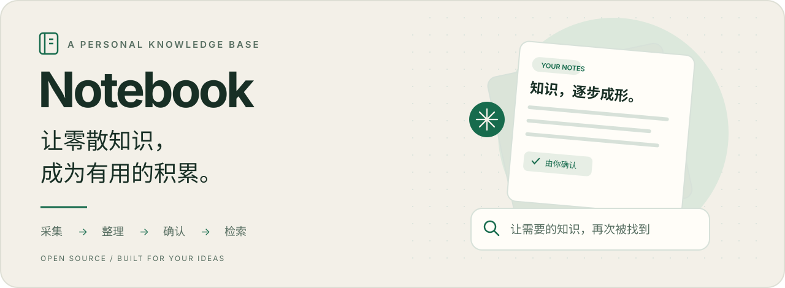
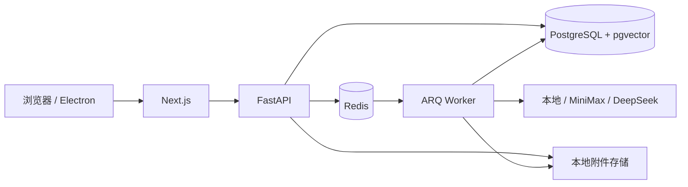

<p align="center">
  <picture>
    <source media="(prefers-color-scheme: dark)" srcset="docs/assets/hero-dark.svg">
    
  </picture>
</p>

<h1 align="center">Notebook · 个人 AI 知识库</h1>

<p align="center">
  收下原始资料，让 AI 帮你整理，由你确认，再通过搜索找回来。<br>
  面向个人使用的开源项目，支持本地 Web 与 macOS 桌面入口。
</p>

<p align="center">
  <a href="LICENSE"></a>
  <a href="#项目状态"></a>
  <a href=".nvmrc"></a>
  <a href=".python-version"></a>
</p>

<p align="center">
  <a href="#核心能力">核心能力</a> ·
  <a href="#快速开始">快速开始</a> ·
  <a href="docs/README.md">文档</a> ·
  <a href="docs/macos-desktop.md">macOS</a> ·
  <a href="https://github.com/XXiangYue/notebook/issues">反馈</a>
</p>

## 为什么做 Notebook

收藏之后的整理和查找，往往比保存本身更费力。Notebook 围绕一条完整的知识处理流程：

**保存资料 → AI 整理 → 人工确认 → 分块索引 → 混合检索**

原文、AI 产物和确认后的内容分别保留版本。正式入库前可以修改 Markdown，让知识库积累的是你认可的内容。

## 核心能力

| 能力 | 你可以做什么 |
| --- | --- |
| **采集与归类** | 保存文本草稿，上传图片、文本、Markdown 或 PDF 附件，按分类浏览知识。 |
| **AI 整理** | 选择 MiniMax 或 DeepSeek，将资料整理为可编辑的 Markdown；也可用本地适配器体验流程。 |
| **确认与版本** | 编辑整理结果后确认入库，保留原始资料及历史内容版本。 |
| **混合检索** | 结合 PostgreSQL 全文检索、pgvector 向量召回和 RRF 排序，找到已确认的知识。 |
| **知识管理** | 查看待整理内容，软删除、恢复或彻底清除知识，管理自定义分类。 |
| **桌面入口** | macOS Electron 启动器统一启动本机服务，退出时清理其启动的进程。 |

> **当前范围：** PDF 支持上传，正文提取尚未实现；图片内容解析目前由 MiniMax 适配器支持。基于知识库的引用问答仍在规划中。

## 快速开始

需要 **Docker Desktop / Docker Compose、uv、fnm、pnpm 10.12.1**。项目使用 Node.js 22 与 Python 3.12，完整环境说明见[开发指南](docs/development-environment.md)。

### 1. 克隆与初始化

```bash
git clone https://github.com/XXiangYue/notebook.git
cd notebook
make setup
make infra-up
make migrate
```

`make setup` 会在缺少配置时从 `.env.example` 创建 `.env`，并安装依赖。运行前请启动 Docker。

### 2. 启动三个进程

在三个终端中分别执行：

```bash
# 终端 1：FastAPI
make api
```

```bash
# 终端 2：异步整理任务
make worker
```

```bash
# 终端 3：Next.js
make web
```

打开 **[Notebook](http://127.0.0.1:3000)**，从“新增知识”保存第一条草稿，再进入详情页整理、确认。API 文档位于 [http://127.0.0.1:8000/docs](http://127.0.0.1:8000/docs)。

默认使用本地模板整理与哈希向量，可在无模型密钥时验证流程。接入真实模型后再评估整理和语义检索效果，具体见 [AI 配置指南](docs/configuration.md)。

<details>
<summary><strong>使用 macOS 桌面入口</strong></summary>

完成初始化后，也可以让 Electron 统一启动服务：

```bash
fnm exec --using=22 -- pnpm dev:desktop
```

无需另行运行上面的三个开发进程。桌面端启动时会构建前端，首次运行需要等待；当前 `.app` 仍依赖本机的源码、开发工具与 Docker。打包及路径配置见 [macOS 文档](docs/macos-desktop.md)。

</details>

## 架构与目录



```text
apps/
  api/             FastAPI 路由、模型与业务服务
  web/             Next.js 页面与 React 组件
  worker/          ARQ 后台任务
  desktop/         Electron 启动器与图标生成脚本
tests/             API 与业务逻辑测试
migrations/        Alembic 数据库迁移
infrastructure/    PostgreSQL / Redis 容器配置
docs/              使用指南、设计文档与展示素材
```

数据库运行在 Docker 中，Web、API 和 Worker 在本机运行。密钥保存在 `.env`，附件与运行时设置保存在 `data/`；这些本地内容不纳入 Git。远程模型的数据处理范围见[配置指南](docs/configuration.md)。

## 文档导航

| 我想…… | 从这里开始 |
| --- | --- |
| 配置环境、启动或排查问题 | [开发环境](docs/development-environment.md) |
| 接入 AI 整理和 embedding | [AI 与检索配置](docs/configuration.md) |
| 运行或打包桌面应用 | [macOS 桌面版](docs/macos-desktop.md) |
| 了解数据结构与设计方向 | [文档索引](docs/README.md) |
| 参与开发 | [贡献指南](AGENTS.md) |

## 项目状态

Notebook 处于 **MVP 开发阶段**，目前已实现采集、整理、确认和检索流程。后续方向包括：

- [ ] PDF 正文提取。
- [ ] 检索评测集与召回参数校准。
- [ ] 基于知识库的回答与引用溯源。
- [ ] 无需本机开发环境的桌面分发方案。

历史设计文档包含尚未实现的目标，当前可用能力以本页和代码为准。

## 参与贡献

欢迎通过 [Issues](https://github.com/XXiangYue/notebook/issues) 报告问题或提出建议。开发约定见 [AGENTS.md](AGENTS.md)。提交前运行：

```bash
make check
```

Pull Request 请说明改动目的与验证结果；界面变更请附截图，配置或数据库变更请同步更新文档。

## License

[MIT](LICENSE) · Copyright © 2026 XXiangYue
