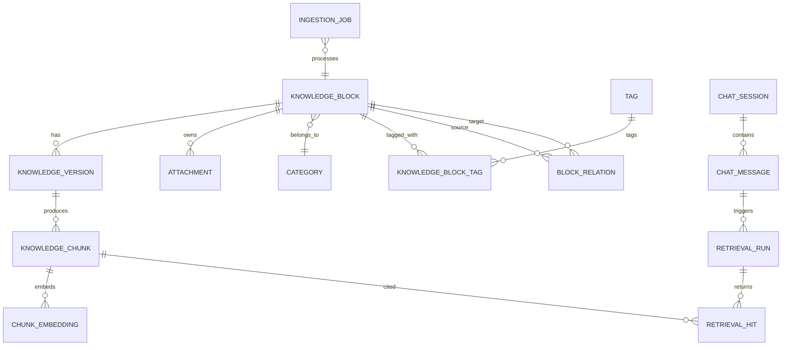

# 知识块与分类数据模型

## 1. 设计目标

数据模型需要同时支持以下能力：

- 保留用户提交的原始资料。
- 保存 AI 整理结果及用户修订版本。
- 使用主分类和标签组织碎片化知识。
- 支持关键词、语义和结构化条件检索。
- 支持引用定位、索引重建和问答复现。
- 支持归档、软删除、派生文档和基础审计。

模型以关系型数据库为事实来源。向量、全文索引和对象存储是可重建的派生数据，不作为唯一数据来源。

## 2. 核心概念

### 2.1 知识块

知识块是用户每次独立提交和管理的最小知识单元。一个知识块可以包含多段原始文本和多个附件，但在产品层面保持一个主题、一个生命周期和一个主分类。

### 2.2 内容版本

知识块的正文不是直接覆盖更新，而是保存为内容版本：

- 原始内容用于追溯用户输入。
- AI 整理版本记录模型产物。
- 用户确认版本代表当前正式内容。
- 编辑后生成新版本，旧版本保留用于审计和回滚。

### 2.3 检索片段

检索片段是从某个正式内容版本中派生的索引单元。片段用于全文检索、向量检索和引用，不等同于知识块。

### 2.4 主分类与标签

- 主分类表达稳定的领域归属，如生活、工作、学校。
- 标签表达跨领域主题、对象、技术或状态，如 AI、金融、待读。
- 主分类数量应保持较少且层级浅；MVP 只支持一级分类。

## 3. 实体关系



## 4. 实体定义

### 4.1 `knowledge_blocks`

知识块的稳定身份、当前状态和常用元数据。

| 字段 | 类型 | 约束 | 说明 |
| --- | --- | --- | --- |
| `id` | UUID | PK | 知识块 ID |
| `title` | VARCHAR(300) | NOT NULL | 当前标题 |
| `summary` | TEXT |  | 当前摘要 |
| `category_id` | UUID | FK | 主分类，允许暂时为空 |
| `status` | ENUM | NOT NULL | 生命周期状态 |
| `current_version_id` | UUID | FK | 当前正式内容版本 |
| `source_type` | ENUM | NOT NULL | manual、import、derived |
| `source_uri` | TEXT |  | 外部来源地址或标识 |
| `language` | VARCHAR(16) |  | 主语言 |
| `created_at` | TIMESTAMPTZ | NOT NULL | 创建时间 |
| `updated_at` | TIMESTAMPTZ | NOT NULL | 更新时间 |
| `confirmed_at` | TIMESTAMPTZ |  | 首次确认时间 |
| `archived_at` | TIMESTAMPTZ |  | 归档时间 |
| `deleted_at` | TIMESTAMPTZ |  | 软删除时间 |

建议状态：

```text
draft
organizing
pending_confirmation
indexing
searchable
index_failed
archived
deleted
```

状态约束：

- 只有 `searchable` 状态默认参与搜索和问答。
- `indexing` 和 `index_failed` 状态仍可在详情页访问。
- `archived` 和 `deleted` 状态必须从默认检索中过滤。
- 状态变化由领域服务统一执行，不能由客户端任意写入。

### 4.2 `knowledge_versions`

保存原始输入、AI 结果和用户编辑后的内容版本。

| 字段 | 类型 | 约束 | 说明 |
| --- | --- | --- | --- |
| `id` | UUID | PK | 版本 ID |
| `knowledge_block_id` | UUID | FK, NOT NULL | 所属知识块 |
| `version_number` | INTEGER | NOT NULL | 块内递增版本号 |
| `version_type` | ENUM | NOT NULL | original、ai_generated、user_confirmed、user_edited |
| `topic_instruction` | TEXT |  | 用户输入的主题或整理要求 |
| `raw_text` | TEXT |  | 原始文本，仅原始版本使用 |
| `markdown_content` | TEXT |  | 整理后的 Markdown |
| `structured_metadata` | JSONB | NOT NULL | 模型输出的结构化元数据 |
| `created_by` | ENUM | NOT NULL | user、system、model |
| `model_run_id` | UUID | FK | 对应模型调用记录 |
| `content_hash` | CHAR(64) | NOT NULL | 内容哈希，用于幂等和变更检测 |
| `created_at` | TIMESTAMPTZ | NOT NULL | 创建时间 |

约束：

- `knowledge_block_id + version_number` 唯一。
- 正式确认前不得删除 `original` 版本。
- `current_version_id` 只能指向同一知识块下的确认或编辑版本。
- 重新生成 AI 内容应新增版本，不覆盖旧结果。

`structured_metadata` 建议结构：

```json
{
  "suggested_title": "示例标题",
  "suggested_summary": "内容摘要",
  "suggested_category": {
    "id": null,
    "name": "工作",
    "confidence": 0.91
  },
  "suggested_tags": [
    {
      "name": "RAG",
      "confidence": 0.95
    }
  ],
  "keywords": ["向量检索", "重排"],
  "image_notes": [
    {
      "attachment_id": "uuid",
      "description": "图片中的主要信息"
    }
  ],
  "warnings": []
}
```

### 4.3 `attachments`

保存图片及后续扩展的文件附件信息。二进制文件位于对象存储或本地受控目录，数据库只保存元数据。

| 字段 | 类型 | 约束 | 说明 |
| --- | --- | --- | --- |
| `id` | UUID | PK | 附件 ID |
| `knowledge_block_id` | UUID | FK, NOT NULL | 所属知识块 |
| `storage_key` | TEXT | UNIQUE, NOT NULL | 存储定位键 |
| `original_filename` | TEXT | NOT NULL | 原文件名 |
| `media_type` | VARCHAR(100) | NOT NULL | MIME 类型 |
| `size_bytes` | BIGINT | NOT NULL | 文件大小 |
| `sha256` | CHAR(64) | NOT NULL | 文件哈希 |
| `width` | INTEGER |  | 图片宽度 |
| `height` | INTEGER |  | 图片高度 |
| `extracted_text` | TEXT |  | OCR 或模型提取文本 |
| `processing_status` | ENUM | NOT NULL | pending、processed、failed |
| `created_at` | TIMESTAMPTZ | NOT NULL | 创建时间 |

安全要求：

- `storage_key` 由服务端生成，不能直接使用用户文件名。
- 上传时验证文件类型、大小和实际内容。
- 文件读取通过附件 ID 完成，不接受客户端传入任意文件路径。

### 4.4 `categories`

| 字段 | 类型 | 约束 | 说明 |
| --- | --- | --- | --- |
| `id` | UUID | PK | 分类 ID |
| `name` | VARCHAR(100) | UNIQUE, NOT NULL | 分类名 |
| `description` | TEXT |  | 分类用途 |
| `color` | VARCHAR(20) |  | 展示颜色 |
| `is_system` | BOOLEAN | NOT NULL | 是否为系统分类 |
| `sort_order` | INTEGER | NOT NULL | 展示顺序 |
| `created_at` | TIMESTAMPTZ | NOT NULL | 创建时间 |
| `updated_at` | TIMESTAMPTZ | NOT NULL | 更新时间 |

MVP 默认分类可设置为：

- 未分类
- 生活
- 工作
- 学习

默认分类只是初始值，用户可以重命名和新增。AI 分类优先匹配已有分类；只有用户确认后才创建新分类。

### 4.5 `tags` 与 `knowledge_block_tags`

`tags`：

| 字段 | 类型 | 约束 | 说明 |
| --- | --- | --- | --- |
| `id` | UUID | PK | 标签 ID |
| `name` | VARCHAR(100) | UNIQUE, NOT NULL | 规范化标签名 |
| `normalized_name` | VARCHAR(100) | UNIQUE, NOT NULL | 用于去重 |
| `usage_count` | INTEGER | NOT NULL | 使用次数缓存 |
| `created_at` | TIMESTAMPTZ | NOT NULL | 创建时间 |

`knowledge_block_tags`：

| 字段 | 类型 | 约束 | 说明 |
| --- | --- | --- | --- |
| `knowledge_block_id` | UUID | PK, FK | 知识块 ID |
| `tag_id` | UUID | PK, FK | 标签 ID |
| `source` | ENUM | NOT NULL | user、ai_accepted |
| `created_at` | TIMESTAMPTZ | NOT NULL | 创建时间 |

标签名在写入前执行空格、大小写和全半角规范化。近义词合并由用户确认，不在 MVP 中自动执行。

### 4.6 `knowledge_chunks`

从当前正式内容版本派生的检索和引用单元。

| 字段 | 类型 | 约束 | 说明 |
| --- | --- | --- | --- |
| `id` | UUID | PK | 片段 ID |
| `knowledge_block_id` | UUID | FK, NOT NULL | 所属知识块 |
| `knowledge_version_id` | UUID | FK, NOT NULL | 来源版本 |
| `chunk_index` | INTEGER | NOT NULL | 版本内顺序 |
| `heading_path` | JSONB | NOT NULL | Markdown 标题路径 |
| `content` | TEXT | NOT NULL | 片段正文 |
| `token_count` | INTEGER | NOT NULL | Token 数 |
| `char_start` | INTEGER |  | 在规范化正文中的起点 |
| `char_end` | INTEGER |  | 在规范化正文中的终点 |
| `content_hash` | CHAR(64) | NOT NULL | 片段哈希 |
| `search_vector` | TSVECTOR |  | 全文检索字段 |
| `is_active` | BOOLEAN | NOT NULL | 是否属于当前有效索引 |
| `created_at` | TIMESTAMPTZ | NOT NULL | 创建时间 |

约束：

- `knowledge_version_id + chunk_index` 唯一。
- 编辑知识块后，旧版本片段设置为非活动状态，新版本索引成功后再原子切换。
- 引用通过片段 ID 和字符位置定位，不依赖前端模糊匹配。

当前 MVP 已实现确认版本的轻量 Markdown 分块：按标题边界优先切分，保存标题路径、字符范围、估算 token 数和内容哈希。全文检索先通过 PostgreSQL 表达式索引和查询时 `to_tsvector` 实现，尚未把 `search_vector` 持久化为独立列；embedding 已写入 `chunk_embeddings`，用于 pgvector 向量召回。

### 4.7 `chunk_embeddings`

将向量和片段解耦，支持嵌入模型升级和并行重建。

| 字段 | 类型 | 约束 | 说明 |
| --- | --- | --- | --- |
| `id` | UUID | PK | 记录 ID |
| `knowledge_block_id` | UUID | FK, NOT NULL | 所属知识块 |
| `knowledge_version_id` | UUID | FK, NOT NULL | 来源版本 |
| `knowledge_chunk_id` | UUID | FK, NOT NULL | 片段 ID |
| `embedding_model` | VARCHAR(100) | NOT NULL | 模型标识 |
| `embedding_dimensions` | INTEGER | NOT NULL | 向量维度 |
| `embedding_vector` | VECTOR | NOT NULL | pgvector 向量 |
| `content_hash` | CHAR(64) | NOT NULL | 片段内容哈希 |
| `created_at` | TIMESTAMPTZ | NOT NULL | 创建时间 |

当前实现支持本地 deterministic provider 和 MiniMax `embo-01`。真实向量使用 1536 维并存入 PostgreSQL `vector(1536)` 列；测试环境使用 SQLite 文本降级。

`knowledge_chunk_id + embedding_model` 唯一。查询只使用当前配置的 `embedding_model`。embedding 是可重建派生数据；更换模型或维度时可清空旧向量并重建。

### 4.8 `block_relations`

记录派生总结与来源知识块等关系。

| 字段 | 类型 | 约束 | 说明 |
| --- | --- | --- | --- |
| `id` | UUID | PK | 关系 ID |
| `source_block_id` | UUID | FK, NOT NULL | 来源块 |
| `target_block_id` | UUID | FK, NOT NULL | 目标块 |
| `relation_type` | ENUM | NOT NULL | derived_from、references、related_to |
| `created_at` | TIMESTAMPTZ | NOT NULL | 创建时间 |

专题总结使用“来源块 `derived_from` 目标总结块”或统一约定的反向语义，实施时必须固定方向。

### 4.9 `ingestion_jobs`

记录 AI 整理、附件解析、分块、嵌入和重建索引任务。

| 字段 | 类型 | 约束 | 说明 |
| --- | --- | --- | --- |
| `id` | UUID | PK | 任务 ID |
| `knowledge_block_id` | UUID | FK, NOT NULL | 目标知识块 |
| `job_type` | ENUM | NOT NULL | organize、extract、chunk、embed、reindex |
| `status` | ENUM | NOT NULL | queued、running、succeeded、failed |
| `idempotency_key` | VARCHAR(200) | UNIQUE, NOT NULL | 幂等键 |
| `attempt_count` | INTEGER | NOT NULL | 尝试次数 |
| `error_code` | VARCHAR(100) |  | 失败代码 |
| `error_message` | TEXT |  | 脱敏错误信息 |
| `started_at` | TIMESTAMPTZ |  | 开始时间 |
| `finished_at` | TIMESTAMPTZ |  | 结束时间 |
| `created_at` | TIMESTAMPTZ | NOT NULL | 创建时间 |

### 4.10 问答与检索记录

#### `chat_sessions`

保存对话标题、创建时间和更新时间。

#### `chat_messages`

保存用户问题、助手回答、角色和对应模型调用。助手回答建议保存结构化引用数组。

#### `retrieval_runs`

记录一次检索的可复现配置：

- 原始问题。
- 解析后的查询。
- 分类、标签和时间过滤条件。
- 关键词检索、向量检索和融合策略版本。
- 召回数量、重排模型和最终证据数量。
- 各阶段耗时。

#### `retrieval_hits`

记录候选片段：

| 字段 | 说明 |
| --- | --- |
| `retrieval_run_id` | 所属检索 |
| `chunk_id` | 命中片段 |
| `keyword_score` | 关键词得分 |
| `vector_score` | 向量得分 |
| `fusion_score` | 融合得分 |
| `rerank_score` | 重排得分 |
| `rank_before_rerank` | 重排前位置 |
| `rank_after_rerank` | 重排后位置 |
| `selected_as_evidence` | 是否进入回答上下文 |

## 5. 模型调用记录

建议使用 `model_runs` 统一记录 AI 整理、查询改写、重排和回答调用：

- `purpose`
- `provider`
- `model`
- `model_config_version`
- `prompt_version`
- `input_token_count`
- `output_token_count`
- `latency_ms`
- `status`
- `error_code`
- `created_at`

出于隐私考虑，不默认保存完整模型请求；需要调试时保存脱敏后的输入摘要或加密载荷。

## 6. 生命周期

### 6.1 首次入库

```text
创建 knowledge_block(draft)
  -> 保存 original version 和附件
  -> AI 整理(organizing)
  -> 保存 ai_generated version(pending_confirmation)
  -> 用户确认，生成 user_confirmed version(indexing)
  -> 生成 chunks 和 embeddings
  -> 原子启用新索引(searchable)
```

### 6.2 编辑与重新索引

```text
创建 user_edited version
  -> 保持旧版本索引可用
  -> 为新版本生成片段和向量
  -> 索引全部成功
  -> 切换 current_version_id 和 active chunks
```

该流程避免重建期间知识块完全不可检索。

### 6.3 删除

软删除时：

1. 设置 `deleted_at` 和 `status=deleted`。
2. 将活动片段设置为不可检索。
3. 保留内容、附件引用和审计数据。
4. 后续永久删除任务再清理数据库、文件和向量。

## 7. 分块与引用要求

- 优先按 Markdown 标题、段落、列表和代码块等结构切分。
- 过长结构块再按 Token 长度切分，并保留适量重叠。
- 不把标题与其首段正文分离。
- 表格和代码块尽量保持完整。
- 每个片段保留标题路径和原文位置，确保引用可定位。
- 分块参数需要版本化；参数变化后允许后台重建索引。

初始参数仅作为评测起点，不写死为业务规则：

- 目标片段长度：约 400 至 800 tokens。
- 最大片段长度：约 1,000 tokens。
- 相邻片段重叠：约 50 至 100 tokens。

## 8. 索引与一致性

数据库是事实来源，索引失败不得破坏正文。

一致性策略：

- 保存内容与投递索引任务使用事务或事务性 Outbox。
- 所有任务带幂等键。
- 向量记录带嵌入版本。
- 只在完整索引成功后切换活动版本。
- 定期校验当前版本、活动片段和向量数量。
- 支持按知识块、版本或全库重新索引。

## 9. 数据保留与隐私

- 原始内容和附件默认长期保留，直到用户永久删除。
- 软删除保留期作为部署配置，MVP 可默认 30 天。
- 问答与检索日志允许用户清除。
- 日志和错误信息不得复制完整正文。
- 外部模型调用前根据配置过滤敏感字段。
- 数据导出应包含知识块正文、元数据、附件清单和来源关系，不依赖向量数据。

## 10. 需要通过评测确定的参数

- 最佳分块长度和重叠比例。
- 标题、摘要、标签是否参与向量文本拼接。
- 中文全文检索的分词方案。
- 向量距离度量和索引参数。
- 混合检索的融合权重。
- 重排候选数量和最终上下文数量。
- 图片提取文本与人工正文的检索权重。
