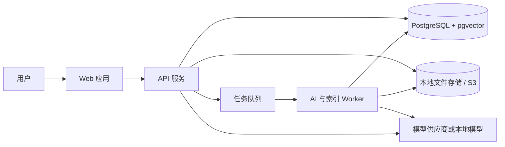

# 个人 AI 知识库 MVP 架构

## 1. 架构目标

本架构服务于首个纵向闭环：

```text
输入资料
  -> AI 整理
  -> 用户确认
  -> 内容保存
  -> 分块与索引
  -> 混合检索
  -> 重排
  -> 基于证据回答并引用
```

设计优先级依次为：

1. 不丢失用户原始资料。
2. 回答可以追溯到明确证据。
3. 组件简单、可本地或私有部署。
4. 模型、嵌入和检索策略可替换。
5. 在真实评测数据出现前不过度设计。

## 2. 推荐技术栈

### 2.1 MVP 选型

| 层级 | 推荐方案 | 选择理由 |
| --- | --- | --- |
| Web 前端 | Next.js + TypeScript | 适合实现知识编辑、搜索和流式问答界面 |
| API 服务 | FastAPI + Python | AI、文档处理和检索生态成熟，便于编排异步任务 |
| 关系数据库 | PostgreSQL | 统一保存知识、版本、分类、日志和任务状态 |
| 向量检索 | pgvector | MVP 无需维护独立向量数据库，事务和过滤更直接 |
| 关键词检索 | PostgreSQL 全文搜索 | 与结构化过滤和向量召回放在同一数据层 |
| 文件存储 | 本地受控目录，接口兼容 S3 | MVP 部署简单，后续可迁移对象存储 |
| 异步任务 | Redis + 轻量任务队列 | 承担 AI 整理、解析、嵌入和重建索引 |
| AI 接入 | 供应商适配层 | 多模态、Embedding、重排和生成模型可独立替换 |
| 文档格式 | Markdown | 可读、可编辑、可导出，便于结构化分块 |

不在文档中锁定具体模型名称和版本。模型能力、成本、隐私和可用性变化较快，应通过配置和评测选择。

### 2.2 为什么 MVP 使用 PostgreSQL + pgvector

- 当前数据规模预计为个人知识库的数万至十万级知识块。
- 分类、标签、时间和状态过滤是核心需求。
- 关系数据、全文索引和向量可以保持较简单的一致性。
- 运维组件少，适合先验证产品价值和检索质量。

以下情况出现后再评估 Qdrant、Milvus、Weaviate 或专用搜索引擎：

- 向量数量和并发显著超过单机 PostgreSQL 的合理容量。
- 需要复杂多租户隔离或跨地域部署。
- 需要更复杂的稀疏向量、向量量化或分布式扩缩容。
- 全文检索质量要求超出 PostgreSQL 能力。

## 3. 系统上下文



职责划分：

- Web 应用：输入、编辑、状态展示、检索结果、流式回答和引用定位。
- API 服务：鉴权、领域规则、事务、查询编排和流式响应。
- Worker：长耗时且可重试的解析、模型调用、分块和嵌入任务。
- PostgreSQL：事实数据、任务状态、全文索引、向量和审计记录。
- 文件存储：原始附件和可导出的 Markdown 文件。
- 模型适配层：统一不同供应商的输入输出、超时、重试和结构化校验。

## 4. 模块划分

建议按业务能力划分，而不是按第三方框架划分：

```text
apps/
  web/                 Web 前端
  api/                 HTTP API 与流式问答
  worker/              异步任务进程

modules/
  knowledge/           知识块、版本、分类、标签
  ingestion/           采集、附件处理、AI 整理
  indexing/            分块、Embedding、索引生命周期
  retrieval/           查询理解、召回、融合、重排
  answering/           上下文构造、回答和引用
  automation/          后续的批量整理与受控工具调用
  audit/               操作与模型调用记录

infrastructure/
  database/
  storage/
  queue/
  models/
```

可以使用框架或库实现模块内部能力，但领域模型和数据格式不应依赖某个 Agent 或 RAG 框架。

## 5. 知识入库链路

### 5.1 创建草稿

1. API 创建 `knowledge_block` 草稿。
2. 原始文本保存为 `original` 内容版本。
3. 附件写入受控存储，数据库保存附件元数据。
4. API 立即返回知识块 ID。

原始资料保存成功是后续所有 AI 操作的前置条件。

### 5.2 AI 整理

Worker 读取主题、原始文本和附件：

1. 验证附件状态、类型和大小。
2. 将图片与文本发送给多模态模型。
3. 要求模型输出符合 JSON Schema 的结构化结果。
4. 服务端校验字段、长度、分类和标签。
5. 将正文转换或组装为 Markdown。
6. 保存 `ai_generated` 版本并进入待确认状态。

建议模型输出：

```json
{
  "title": "标题",
  "summary": "摘要",
  "markdown": "# 标题\n\n正文",
  "category": {
    "existing_category_id": null,
    "suggested_name": "工作"
  },
  "tags": ["RAG", "知识管理"],
  "keywords": ["混合检索", "引用"],
  "warnings": []
}
```

模型不得直接写数据库、创建分类或移动文件。所有副作用由服务端在校验和用户确认后执行。

### 5.3 用户确认和索引

用户确认后：

1. 创建 `user_confirmed` 内容版本。
2. 更新标题、摘要、主分类和标签。
3. 通过事务性 Outbox 投递索引任务。
4. Worker 按 Markdown 结构分块。
5. 批量生成 Embedding。
6. 写入全文索引和向量。
7. 全部成功后切换活动版本并标记为可检索。

索引任务失败时保留正式内容，记录失败原因并允许按幂等键重试。

## 6. RAG 检索方案

### 6.1 查询理解

输入为用户问题和可选界面筛选条件。查询理解层输出结构化对象：

```json
{
  "search_query": "用于语义检索的完整查询",
  "keywords": ["关键词一", "关键词二"],
  "category_ids": [],
  "tag_ids": [],
  "time_range": null,
  "intent": "question_answering"
}
```

原则：

- 界面中用户明确选择的过滤条件优先于模型推断。
- 模型只能从已有分类和标签中选择。
- 查询理解失败时退化为使用原始问题搜索。
- 简单关键词搜索不强制调用大模型。

### 6.2 候选召回

并行执行两路召回：

1. 关键词召回：标题、摘要、标签、标题路径和片段正文。
2. 向量召回：对用户问题生成查询向量，检索语义相近片段。

两路查询都应用相同的状态、分类、标签和时间过滤条件。

初始候选规模可设为：

- 关键词召回 Top 30。
- 向量召回 Top 30。
- 融合去重后保留 Top 40。

具体数值必须通过评测集调整。

当前 MVP 已落地关键词召回、向量召回和融合排序：`/search` 基于 `knowledge_chunks` 的活动分块检索，只返回 `searchable` 且未软删除的知识块。PostgreSQL 环境使用 `to_tsvector('simple', ...)` 和 `websearch_to_tsquery('simple', ...)`，同时用标题和正文 `ILIKE` 兜底中文短语命中；向量召回使用 `chunk_embeddings.embedding_vector` 的 pgvector cosine distance；最终使用 RRF 合并两路排名。SQLite 测试环境使用 `LIKE` 和 Python cosine 降级。

Embedding provider 支持 `local` 和 `minimax`。`local-hash-embedding-v1` 只用于离线测试和链路验证；MiniMax provider 使用 `embo-01`，向量维度为 1536。更换 embedding 模型或维度时，旧向量作为派生数据清空并由搜索路径自动重建。后续需要用评测集校准召回规模、RRF 参数和相似度阈值。

### 6.3 结果融合

MVP 推荐使用 Reciprocal Rank Fusion（RRF）融合关键词与向量排名。它比直接混合不同量纲的原始分数更容易稳定落地。

可附加少量业务规则：

- 标题精确命中加权。
- 用户明确筛选的分类和标签不再额外加权，只作为硬过滤。
- 同一知识块进入重排的片段数量设上限，避免单篇长文占满候选。

所有权重和参数记录为 `retrieval_config_version`。

### 6.4 重排

对融合后的候选使用独立 reranker 进行相关性重排：

- 输入：用户问题、片段正文、标题路径和知识块标题。
- 输出：相关性分数。
- 最终选择约 5 至 10 个片段进入回答上下文。

若外部 reranker 不可用，可临时使用融合排名作为降级方案。生成模型不应承担大规模候选重排，以控制延迟和成本。

### 6.5 上下文构造

上下文构造器负责：

- 去除高度重复片段。
- 合并同一知识块中相邻且相关的片段。
- 控制单个知识块和总上下文 Token 数。
- 为每个片段分配稳定引用编号。
- 保留知识块 ID、片段 ID、标题和标题路径。

传给回答模型的每条证据采用明确边界，防止知识正文被解释为系统指令。

### 6.6 回答生成

回答模型必须遵守：

1. 只依据提供的知识库证据回答。
2. 每个关键事实使用引用编号。
3. 证据冲突时指出冲突及各自来源。
4. 证据不足时明确说明，不利用模型常识补造知识库结论。
5. 输出结构包含回答正文和引用列表。

服务端校验引用编号是否真实存在于本次上下文中。无效引用应触发修复或降级，而不是直接返回用户。

## 7. 多模态处理

MVP 图片处理采用视觉模型直接理解，必要时结合 OCR：

- 截图、图表和排版复杂图片优先使用多模态模型。
- 文本密集图片可先 OCR，再把 OCR 文本和图片共同交给模型校正。
- 图片提取结果保存在附件记录和内容版本中。
- 低置信度或无法读取的图片显示告警，允许用户补充说明。

图片原文件始终保留，提取文本属于可重建派生数据。

PDF 不属于首个 MVP。后续接入时先按 PDF 类型路由：

- 文本型 PDF：结构化文本提取。
- 扫描型 PDF：页面图像 + OCR。
- 复杂图文 PDF：版面分析或多模态处理。

## 8. API 边界

建议的核心 API：

```text
POST   /knowledge-blocks
GET    /knowledge-blocks
GET    /knowledge-blocks/{id}
PATCH  /knowledge-blocks/{id}
POST   /knowledge-blocks/{id}/organize
POST   /knowledge-blocks/{id}/confirm
POST   /knowledge-blocks/{id}/reindex
POST   /knowledge-blocks/{id}/archive
DELETE /knowledge-blocks/{id}

GET    /categories
POST   /categories
GET    /tags

POST   /search
POST   /chat/sessions
POST   /chat/sessions/{id}/messages
GET    /jobs/{id}
```

创建、整理、确认和重建索引接口支持幂等键。问答接口使用 SSE 或等价机制流式返回：

- 检索状态。
- 回答文本增量。
- 最终引用和完成状态。

## 9. AI 适配层

不要在业务代码中直接调用供应商 SDK。定义内部接口：

```text
MultimodalOrganizer
EmbeddingProvider
RerankProvider
AnswerGenerator
QueryInterpreter
```

每个接口统一处理：

- 输入输出数据结构。
- 超时和取消。
- 有限次数重试。
- 限流。
- Token 和成本统计。
- 模型及提示词版本。
- 结构化输出校验。

模型选择由配置决定，不同能力可以来自不同供应商或本地模型。

## 10. 文件与工具执行边界

### 10.1 MVP 允许

- 读取用户通过产品上传的附件。
- 在配置的知识库目录创建新的 Markdown 文件。
- 创建文件前规范化并验证目标路径。
- 文件已存在时要求用户确认覆盖或生成新文件名。

### 10.2 MVP 禁止

- 读取知识库工作目录以外的任意文件。
- 执行模型自由生成的 Shell 命令。
- 未确认地覆盖、移动或删除文件。
- 将访问密钥、环境变量或系统提示发送给模型。

### 10.3 后续安全模型

后续命令能力应使用显式工具定义，而不是开放原始终端：

- 工具采用固定名称和 JSON 参数。
- 参数经过 Schema 校验和路径策略检查。
- 只允许预先配置的命令或业务操作。
- 在独立沙箱中执行，设置 CPU、内存、网络和时间限制。
- 修改性操作需要预览、确认和审计。

## 11. 安全与隐私

- API 密钥只存在服务端密钥存储或环境配置中。
- 上传文件执行大小、MIME、扩展名和内容检查。
- 所有文件路径使用服务端生成的存储键，阻止路径穿越。
- 用户内容发送外部模型前遵循部署配置和隐私提示。
- 数据库、备份和对象存储根据部署环境启用加密。
- 日志默认记录 ID、状态和耗时，不记录完整知识正文。
- 检索时在数据库查询层强制应用用户或空间过滤，不能只依赖提示词。
- 把检索内容视为不可信数据，防范提示词注入影响系统指令或工具调用。

## 12. 可观测性

每个请求生成 `trace_id`，贯穿 API、任务、模型调用和检索记录。

关键指标：

- 草稿保存成功率。
- AI 整理成功率、耗时和 Token 消耗。
- 附件处理失败率。
- 分块数量和平均长度。
- Embedding 成功率和积压任务数。
- 搜索 P50/P95 延迟。
- 重排延迟。
- 问答首 Token 时间和总耗时。
- 无答案率、无效引用率和用户反馈。

关键版本信息：

- `prompt_version`
- `model_config_version`
- `chunking_version`
- `embedding_version`
- `retrieval_config_version`

## 13. 测试与评测

### 13.1 自动化测试

- 领域状态流转单元测试。
- 分类、标签和路径校验测试。
- 分块器针对标题、列表、表格和代码块的测试。
- 索引任务幂等与失败重试测试。
- 混合检索过滤条件测试。
- 引用编号和片段定位测试。
- 软删除、归档和编辑后的索引一致性测试。
- 模型适配层使用固定响应的契约测试。

### 13.2 RAG 评测集

首批准备 30 至 50 个真实知识块，并为每个能力建立样例：

- 原文关键词命中。
- 同义表达和语义命中。
- 分类、标签和时间过滤。
- 需要组合多个片段的问题。
- 知识库无答案的问题。
- 内容冲突的问题。
- 图片中才能找到答案的问题。

核心指标：

- Recall@5 和 Recall@10。
- MRR 或 nDCG。
- 重排前后提升。
- 答案忠实度。
- 引用正确率和引用覆盖率。
- 无答案判断准确率。

模型或检索参数的更换必须基于该评测集对比，而不是只看个别演示效果。

## 14. 部署拓扑

MVP 可使用单机容器化部署：

```text
reverse-proxy
web
api
worker
postgresql
redis
local-storage-volume
```

部署要求：

- 数据库与附件目录定期备份。
- API 和 Worker 使用相同的模型配置版本。
- 数据库迁移由单独步骤执行。
- 健康检查区分进程存活、数据库连接和任务队列连接。
- 模型供应商故障不应影响已保存知识的浏览和关键词搜索。

## 15. 实施顺序

### 里程碑 1：知识管理基础

- 知识块、版本、分类、标签和附件数据结构。
- 草稿创建、详情、编辑、归档和软删除。
- Markdown 编辑和预览。

### 里程碑 2：AI 整理

- 多模态模型适配层。
- 结构化整理结果。
- 用户确认和版本保存。
- 异步任务与失败重试。

### 里程碑 3：索引与搜索

- Markdown 分块。
- Embedding 和 pgvector 索引。
- PostgreSQL 全文检索。
- 混合召回、筛选和结果展示。

### 里程碑 4：知识问答

- 查询理解。
- 候选融合和重排。
- 上下文构造、流式回答和引用定位。
- 问答记录与 RAG 评测。

### 里程碑 5：受控批量整理

- 指令解析与范围预览。
- 派生知识块和来源关系。
- 受控 Markdown 文件生成。
- 确认、审计和失败恢复。

## 16. 关键技术边界

MVP 明确接受：

- 单用户优先。
- PostgreSQL 同时承担业务数据、全文和向量检索。
- 最终一致的异步索引。
- 外部模型可暂时不可用，但核心知识数据必须可访问。

MVP 明确不做：

- 让大模型直接访问数据库或文件系统。
- 让 Agent 自主决定并执行任意命令。
- 用向量数据库代替关系数据库保存事实数据。
- 用单一向量检索替代关键词和结构化过滤。
- 在没有评测集时持续堆叠复杂 RAG 框架。

## 17. 架构决策待办

进入实现前需要用小型技术验证确定：

1. 中文全文检索采用 PostgreSQL 内置能力还是附加分词扩展。
2. 首选多模态、Embedding 和 reranker 的供应商及降级方案。
3. 异步任务库的具体选择。
4. Markdown 分块器是自研轻量实现还是采用现有解析库。
5. 首批部署是纯本地模式还是默认调用云模型。
6. 数据导出和备份格式。
